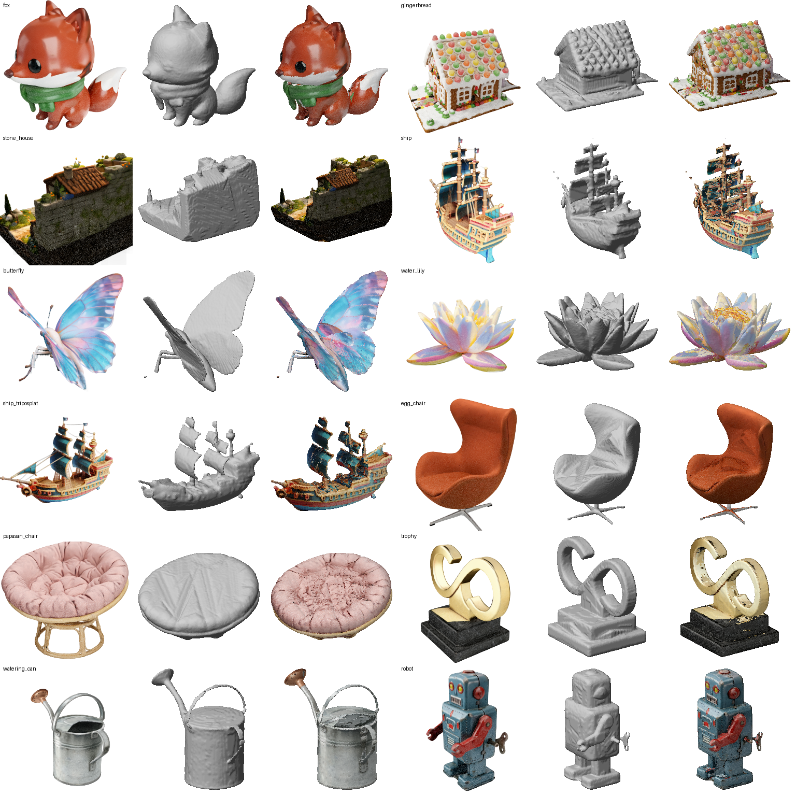
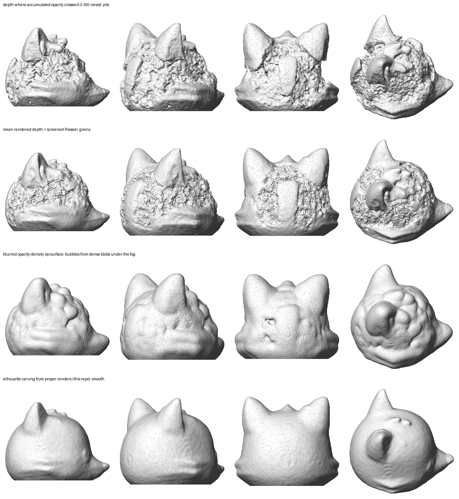

# splat2stl

Turn a 3D Gaussian Splat (`.ply`) of a single object into a **watertight, printable STL** (plus a vertex-colored OBJ) in 8–16 seconds on an 8 GB GPU.

Image-to-3D generators such as [Idol](https://huggingface.co/speridlabs/idol) and [TripoSplat](https://github.com/VAST-AI-Research/TripoSplat) output Gaussian splats, not meshes. splat2stl renders the splat from many directions with a small pure-PyTorch rasterizer, takes the object's outline in every view, and carves a voxel block down to the shape that matches all outlines (a *visual hull*). The result is a closed solid that you can drop into a slicer.

Write-up of how we got here (four failed attempts and why): [I wanted to 3D-print a fox an AI made from one picture. The fix was to stop looking for its surface](https://dev.to/helgard_orlm/i-wanted-to-3d-print-a-fox-an-ai-made-from-one-picture-the-fix-was-to-stop-looking-for-its-surface-1i18) (dev.to).



*Each triple shows the splat rendered by splat2stl, the STL (gray), and the colored OBJ, from the same angle. Eleven objects were generated with Idol and `ship_triposplat` with TripoSplat. All 12 meshes are watertight (trimesh `is_watertight`).*

## Usage

```bash
pip install torch numpy scipy scikit-image trimesh plyfile pillow   # or: pip install -e .
python -m splat2stl fox.ply out/fox --height 80
# -> out/fox.stl (geometry, Z up, millimetres) and out/fox_color.obj (vertex colors)
```

| flag | default | meaning |
|---|---|---|
| `--height` | 80 | size along the up axis in mm (the mesh stands on Z=0) |
| `--up` | `-y` | up axis of the splat (`-y` for Idol, TripoSplat and most 3DGS generators) |
| `--views` | 140 | render directions on a sphere (views more than 60° below the horizon are skipped) |
| `--res` | 256 | voxel grid resolution along the longest side |
| `--img` | 512 | render resolution |
| `--smooth` | 1 | 0..5, blur of the voxel solid plus Taubin smoothing |
| `--alpha` | 0.5 | accumulated opacity that counts as "object" in an outline |
| `--device` | cuda | `cpu` works but is slow |

From Python: `from splat2stl import splat_to_mesh; info = splat_to_mesh("fox.ply", "out/fox", height_mm=80)`.

The command prints a JSON summary: `watertight`, `tunnels` (genus, i.e. through-holes such as a handle or an arch), `volume_cm3`, `size_mm`, `fog_fraction` and `seconds`.

## Why outlines and not depth

Generators often build parts of an object out of many **nearly transparent Gaussians**. On the Idol fox above, the head is made of tens of thousands of layered Gaussians with a median opacity of **0.01**. Only 4% of them exceed 0.5, compared with 0.85 and 67% on the body. Across the whole fox, 51% of the Gaussians have opacity below 0.1. Other seeds of the same input gave 47–54%, so this comes from how the model sees the image, not from an unlucky seed. The viewer composites these layers into a smooth, opaque-looking head, but **there is no well-defined surface inside such "fog"**. The visible depth differs from view to view, so every depth-based extraction turns that disagreement into artifacts:



The *outline*, on the other hand, is well defined even for fog, because opacity accumulated through the whole head is high. Taking the outline from proper renders (accumulated alpha > 0.5, which is what you see in the viewer) and intersecting outlines from many directions gives a clean, smooth solid.

We also tried multi-view stereo on the renders (COLMAP patch-match with the known cameras). The depth was accurate where it existed: median error 0.004 splat units against the rendered depth, ≈0.35 mm at an 80 mm print. It was valid on 44–58% of the object in each view. Using it to carve concavities, however, roughened smooth areas, so it is not part of the default pipeline.

## How it works

1. **Load** the splat: positions, DC color, opacity, scale, rotation. Only the view-independent color is used.
2. **Render** N views on a Fibonacci sphere with `splat2stl/render.py`. This is a pure-PyTorch 3DGS rasterizer: EWA covariance projection, per-pixel alpha `opacity·exp(−½dᵀΣ⁻¹d)`, and exact front-to-back compositing via a sort and a segmented cumulative log-transmittance. There is no CUDA extension to compile.
3. **Carve**: a voxel is removed if it projects outside the outline in any view. Interior cavities are filled, and the largest component is kept.
4. **Mesh**: marching cubes, Taubin smoothing, then rotation to Z-up and scaling to millimetres.
5. **Color**: each vertex takes the color of the render that sees it most frontally.

## Limitations (please read before printing)

- **Concavities hidden in every outline are filled.** This is inherent to visual hulls. Examples are the dip of a bowl-shaped chair or the inside of a cup or watering can (see `papasan_chair` and `watering_can` above). Through-holes that are visible in some outline, such as handles and arches, are preserved.
- **Very thin parts disappear.** Parts thinner than about two voxels (≈0.6 mm on an 80 mm print at the default `--res 256`) are lost to smoothing. Examples are ship rigging and the thin rattan stand of `papasan_chair`. Raise `--res` and lower `--smooth` to keep more, at the cost of time and memory.
- **Lighting is baked into the colors.** Highlights painted into the input image (for example, glossy plastic) appear as light patches in the OBJ colors. The geometry is unaffected.
- **Single objects only.** It assumes an object-centric splat. It does not handle scenes or splats with large background floaters, since only the largest component is kept.
- **Memory**: peak ≈2.4 GB allocated by PyTorch at the defaults (`--img 384` needs ≈1.8 GB). It runs on an 8 GB card next to a small loaded model; close other GPU programs if you hit out-of-memory.

Tested on the 12 objects shown above (Idol and TripoSplat outputs), on an RTX 5060 8 GB, with PyTorch 2.11 and Python 3.13. It took 8–16 s per object at the defaults.

| object | watertight | tunnels | volume, cm³ | fog fraction | seconds |
|---|---|---|---|---|---|
| fox | yes | 0 | 96.2 | 0.51 | 16.2 |
| gingerbread | yes | 2 | 394.3 | 0.01 | 11.2 |
| stone_house | yes | 33 | 406.9 | 0.03 | 14.6 |
| ship | yes | 3 | 37.5 | 0.07 | 10.2 |
| butterfly | yes | 1 | 14.6 | 0.13 | 11.0 |
| water_lily | yes | 1 | 401.8 | 0.27 | 13.8 |
| ship_triposplat | yes | 0 | 42.0 | 0.08 | 8.4 |
| egg_chair | yes | 0 | 74.1 | 0.14 | 12.2 |
| papasan_chair | yes | 0 | 623.3 | 0.0 | 12.1 |
| trophy | yes | 0 | 91.6 | 0.21 | 13.6 |
| watering_can | yes | 1 | 90.5 | 0.09 | 9.2 |
| robot | yes | 3 | 46.5 | 0.02 | 9.9 |

`tunnels` counts every through-hole, including small slits between thin parts (the stone house has an arch, windows and a few such slits). Check the mesh in your slicer.

## Prior art and credits

- Visual hull / shape from silhouette: A. Laurentini, *The visual hull concept for silhouette-based image understanding*, IEEE TPAMI 1994. The carving idea is classical; this repo applies it to Gaussian splats with outlines taken from properly composited renders.
- 3D Gaussian Splatting: Kerbl et al., SIGGRAPH 2023.
- Other splat-to-mesh tools: [3DGS-to-PC](https://github.com/Lewis-Stuart-11/3DGS-to-PC) (Poisson on sampled points) and [fVDB](https://fvdb-reality-capture.readthedocs.io/) (TSDF from rendered depth). Those approaches recover concavities on clean, opaque splats. splat2stl is aimed at fog-heavy generator outputs and at a solid that is closed by construction, for printing.
- Test objects: generated with [Idol](https://huggingface.co/speridlabs/idol) (Apache-2.0) from its demo images (7 objects) and from TripoSplat's example images (4 objects), plus one object generated with [TripoSplat](https://github.com/VAST-AI-Research/TripoSplat) (MIT).

## License

MIT
